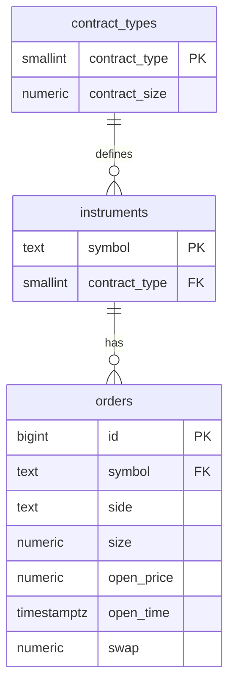

# PostgreSQL — SQL setup and Prisma integration

This guide preserves the historical SQL setup. The API now reads instruments through [Prisma](../api/prisma/README.md) from a separate database. `GET /orders` and `GET /contract-types` still read `api/data/*.json`, including an empty response for `GET /orders?status=closed`. There is no `status` column or closed order data.

## Start with Docker Compose

Install Docker with Compose v2 and start its Linux container engine. From the repository root:

Copy `.env.example` to `.env` and set a nonempty `POSTGRES_PASSWORD` there, or supply it through the environment. Compose rejects a missing or empty password before starting the service. `.env` is ignored by Git; the example contains no password.

```bash
docker compose up -d --wait
docker compose ps
npm run test:db -- --docker
docker compose exec postgres psql -X -U trading -d trading_orders
```

Connection settings: host `127.0.0.1`, port `5432`, database `trading_orders`, user `trading`, and the password supplied above. The Compose setup is for local development and the port is bound only to the loopback interface. If port 5432 is occupied, set `POSTGRES_PORT` before starting Compose (for example, `$env:POSTGRES_PORT = '5433'` in PowerShell). For a shared or deployed environment, use its secret management mechanism and separate credentials. Changing `POSTGRES_PASSWORD` does not rotate the password in an already initialized database.

The healthcheck uses `pg_isready -h 127.0.0.1` to check TCP readiness. The temporary initialization server only accepts Unix socket connections, so it cannot satisfy this healthcheck before the schema and seed scripts finish.

The named volume `postgres_data` preserves data across `docker compose stop` and `docker compose down`. Start again with `docker compose up -d --wait`. The image runs `init/01-schema.sql` followed by `init/02-seed.sql` only when its data directory is empty. Editing those files does not modify an existing database; they are initial setup scripts, not repeatable migrations. See the [official image documentation](https://hub.docker.com/_/postgres) for initialization and the PostgreSQL 18 volume layout.

## Prisma migrations in stage 03

The Prisma schema, committed migrations and repeatable fixture seed are in `api/prisma`; see [the stage 03 guide](../api/prisma/README.md). They target a separately created, initially empty `trading_orders_prisma_dev` database through the ignored local `DATABASE_URL`. The historical `trading_orders` database and SQL initialization below remain available for practice.

Only `GET /instruments` uses the Prisma-managed database. The shared client factory limits connection/handshake and pool checkout to 1,000 ms and SQL statements to 2,000 ms through PostgreSQL's `statement_timeout`, including time spent waiting for locks. These session settings also apply to seed and verify; they do not alter the SQL initialization scripts, database-wide settings or committed migration. Database failures produce a generic HTTP 500 without a fixture fallback. See [Prisma data access and timeout details](../api/prisma/README.md#nestjs-data-access).

Do not run the initial Prisma migration against tables already created by `db/init/01-schema.sql`. Adopting that existing database requires a separately planned baseline matching its schema and data. This stage does not establish that baseline, reset the existing database or delete its volume. Future changes to the Prisma-managed database should use new migrations, with the SQL CHECK constraints reviewed explicitly.

## Checking first-time initialization

Use a separate Compose project and an unused port to test a fresh volume without touching the normal database. After configuring the password, run in a separate PowerShell terminal:

```powershell
$env:COMPOSE_PROJECT_NAME = 'trading-orders-review-1'
$env:POSTGRES_PORT = '55432'
docker compose up -d --wait
npm run test:db -- --docker
docker compose logs postgres
docker compose down
```

Both commands use `COMPOSE_PROJECT_NAME`, so the tests target this isolated service. Check that initialization finishes before the final TCP server is ready and the service becomes healthy. Repeat with a new project name such as `trading-orders-review-2` and a free port to exercise another empty volume. `down` preserves each project's volume; do not use volume deletion to apply schema changes to an existing database.

## Model



- Natural keys preserve fixture identifiers: `contractType` becomes `contract_type`, `symbol` identifies an instrument, and `id` identifies an order.
- `orders.symbol` references `instruments.symbol`; `instruments.contract_type` references `contract_types.contract_type`. Updates and deletes of referenced keys are restricted.
- All fields are required. `side` allows only `BUY` and `SELL`; contract size, order size and opening price must be positive and finite. Swap can be negative, zero or positive, and must be finite. Foreign key columns have indexes.
- `numeric` keeps decimal values exactly, including small swaps such as `-0.00000026`. No fixed scale rounds the fixture values.
- JSON `openTime` is Unix time in milliseconds. The seed stores the same instant as `timestamptz` with explicit UTC offsets. To return milliseconds later, use `(extract(epoch FROM open_time) * 1000)::bigint`.
- The seed is a snapshot of all three fixtures: **6 contract types, 108 instruments, 213 open orders**. SQL column names use snake case. The JSON files remain unchanged.

## JOIN, grouping and constraints

In the Compose `psql` session:

```sql
\dt
\d orders
\i /workspace/db/queries.sql
\i /workspace/db/verify.sql
```

Or execute the scripts directly from the repository root:

```bash
docker compose exec -T postgres psql -X -v ON_ERROR_STOP=1 -U trading -d trading_orders -f /workspace/db/queries.sql
docker compose exec -T postgres psql -X -v ON_ERROR_STOP=1 -U trading -d trading_orders -f /workspace/db/verify.sql
```

`queries.sql` contains two SELECTs:

1. A JOIN across `orders`, `instruments`, and `contract_types`, returning all **213** orders with their symbols, sides, sizes, opening prices/times, swaps and contract sizes. For example, order `1203384` has symbol `BTCUSD`, size `0.05`, opening price `104837.47`, swap `-0.00147939`, and contract size `1`. Current quotes still come from the WebSocket, so this query supplies the stored inputs to the profit calculation.
2. A `GROUP BY symbol` returning **108** groups, with order counts, total size, arithmetic mean opening price and total swap, matching the current dashboard grouping. Examples: `BTCUSD` has **3** orders and total size **0.07**; `EURPLN` has **22** orders and total size **0.22**.

## Repeatable database tests

After starting Compose, run from the repository root:

```bash
npm run test:db -- --docker
```

This command runs `verify.sql`, then compares every database record with all three tracked `api/data/*.json` fixtures using `db/tests/check-fixtures.mjs`. No interactive `psql` session is needed. To run only the fixture comparison, use `npm run test:db:fixtures -- --docker`.

For a native PostgreSQL server, put `psql` on `PATH` (Windows `psql.exe` works too), or set `PSQL` to its full executable path. Configure the connection through `PGHOST`, `PGPORT`, `PGUSER`, `PGPASSWORD` and optionally `PGDATABASE`. Defaults are `127.0.0.1`, `5432`, `trading` and `trading_orders`; the password has no default and can also come from libpq's password file. For example, in PowerShell:

```powershell
$env:PSQL = 'C:\path\to\pgsql\bin\psql.exe'
$env:PGHOST = '127.0.0.1'
$env:PGPORT = '5432'
$env:PGUSER = 'trading'
$env:PGPASSWORD = 'trading_local'
$env:PGDATABASE = 'trading_orders'
npm run test:db
```

On Linux/macOS, an equivalent invocation is `PGPASSWORD=trading_local npm run test:db` with `psql` on `PATH`. The Docker option runs the client inside the Compose service using its configured `trading` user and `trading_orders` database; it does not need a host `psql` installation or host connection variables.

`verify.sql` checks seed/JOIN counts and **39 expected rejections**: both missing foreign keys, deletion and updates of referenced keys, zero order size, invalid side, negative opening price, infinite opening time, duplicate/zero/negative order IDs, zero and negative contract sizes, empty and whitespace-only instrument symbols, `NaN` and both infinities in every numeric column, and `NULL` in all 11 required columns across the three tables. Each case catches its expected SQLSTATE (`23503`, `23001`, `23514`, `23505`, or `23502`); a different error fails the command. Expected rejections print `PASS` notices. Unexpected acceptance raises an exception and makes the command exit with an error. All constraint checks run in a transaction that is rolled back.

The read-only fixture comparison checks all fields, including swaps and timestamps converted back to Unix milliseconds. Numeric JSON tokens are compared as exact decimal values without rounding through JavaScript `number`. Any difference, SQL error, connection error or missing executable gives a nonzero exit status. These tests use the existing initialized database and never reset or reseed it. Separately, `npm run test:api` requires the seeded Prisma database configured by `DATABASE_URL` and verifies instrument data through the real HTTP endpoint; see [the Prisma guide](../api/prisma/README.md#generate-migrate-and-seed).

The API suite runs its files serially and includes real TCP handshake failure, unavailable database, and SQL lock/timeout regressions. The exclusive-lock test only accepts a loopback connection to `trading_orders_prisma_dev`, rolls back the blocking transaction in `finally`, and verifies recovery to all 108 instruments. It also checks server-side SQL cancellation after an HTTP abort and bounded application shutdown. Do not run another API suite or seed concurrently. Run `npm run db:verify` afterwards to confirm the original 6/108/213 snapshot and removal of temporary test instruments. `test:db -- --docker` continues to target the historical `trading_orders` database, not the Prisma HTTP test database.

To see the raw foreign key error yourself, execute these statements interactively, then roll back:

```sql
BEGIN;
INSERT INTO orders (id, symbol, side, size, open_price, open_time, swap)
VALUES (999999999, '__MISSING_INSTRUMENT__', 'BUY', 0.01, 1, now(), 0);
-- Expected: SQLSTATE 23503, constraint orders_instrument_fk.
ROLLBACK;
```

## Windows without Docker

The stage was verified using PostgreSQL 18.6 Windows binaries from the [EDB ZIP distribution linked by PostgreSQL](https://www.postgresql.org/download/windows/). No Windows service is needed. The local runtime and data are in the ignored `tmp/postgresql` directory; they are not committed. Download the ZIP from [EDB](https://www.enterprisedb.com/download-postgresql-binaries) and extract its `pgsql` folder there (the server needs `bin`, `lib`, and `share`).

For a **new** data directory, run from the repository root in PowerShell:

```powershell
$pgBin = Join-Path (Get-Location) 'tmp/postgresql/pgsql/bin'
$env:PGPASSWORD = 'trading_local'
Set-Content tmp/postgresql/password.txt 'trading_local' -Encoding ascii
& "$pgBin/initdb.exe" -D tmp/postgresql/data -U trading --pwfile=tmp/postgresql/password.txt --auth=scram-sha-256 --encoding=UTF8 --locale=C
# Continue only if initdb succeeded.
Add-Content tmp/postgresql/data/postgresql.conf "`nlisten_addresses = '127.0.0.1'`nport = 5432`ntimezone = 'UTC'"
Remove-Item tmp/postgresql/password.txt
& "$pgBin/pg_ctl.exe" -D tmp/postgresql/data -l tmp/postgresql/server.log -w start
& "$pgBin/createdb.exe" -h 127.0.0.1 -U trading trading_orders
& "$pgBin/psql.exe" -X -v ON_ERROR_STOP=1 -h 127.0.0.1 -U trading -d trading_orders -f db/init/01-schema.sql
& "$pgBin/psql.exe" -X -v ON_ERROR_STOP=1 -h 127.0.0.1 -U trading -d trading_orders -f db/init/02-seed.sql
```

For an **existing initialized** local database, skip initialization, database creation and seed loading. To start it after a restart:

```powershell
$pgBin = Join-Path (Get-Location) 'tmp/postgresql/pgsql/bin'
$env:PGPASSWORD = 'trading_local'
& "$pgBin/pg_ctl.exe" -D tmp/postgresql/data -l tmp/postgresql/server.log -w start
```

Run the same automated verification, inspect the queries and open an interactive session:

```powershell
$env:PSQL = Join-Path $pgBin 'psql.exe'
npm run test:db
& "$pgBin/psql.exe" -X -v ON_ERROR_STOP=1 -h 127.0.0.1 -U trading -d trading_orders -f db/queries.sql
& "$pgBin/psql.exe" -X -h 127.0.0.1 -U trading -d trading_orders
```

Stop the portable server with `& "$pgBin/pg_ctl.exe" -D tmp/postgresql/data -m fast -w stop`. The portable server and Compose cannot both use host port 5432 at once; stop one first or give Compose another port.
